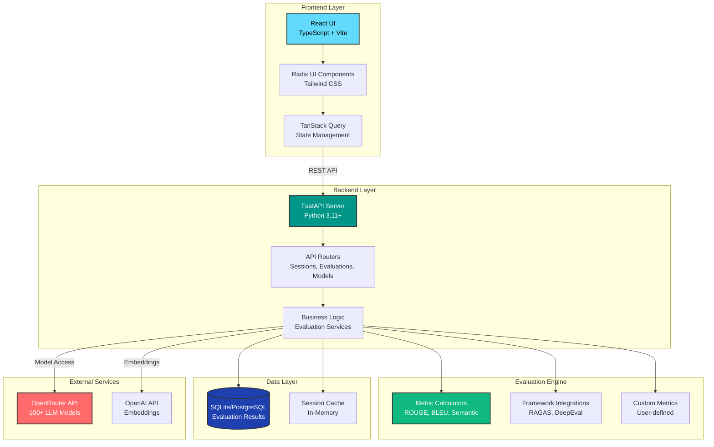

# 🎯 LLM Evaluation Platform

A comprehensive web-based platform for evaluating Large Language Model outputs using industry-standard metrics. Built with React, TypeScript, and FastAPI, this platform supports both manual single-entry evaluation and bulk CSV processing with rich visualizations and analytics.

[](LICENSE)
[](https://reactjs.org/)
[](https://fastapi.tiangolo.com/)
[](https://www.typescriptlang.org/)

## 🏗️ Architecture Overview



## ✨ Key Features

### 🎨 Frontend
- **Modern React Stack**: React 19, TypeScript, Vite for blazing-fast development
- **Rich UI Components**: Radix UI primitives with Tailwind CSS styling
- **Interactive Visualizations**: D3.js and Recharts for data insights
- **Responsive Design**: Mobile-first approach with container queries
- **State Management**: TanStack Query for efficient data fetching

### ⚡ Backend
- **FastAPI Framework**: High-performance async Python API
- **Multiple Evaluation Metrics**: ROUGE, BLEU, semantic similarity, coherence
- **Session Management**: Organize and track evaluation workflows
- **Bulk Processing**: Handle 1000+ evaluations efficiently
- **Model Integration**: Access 100+ LLMs via OpenRouter

### 📊 Evaluation Capabilities
- **Manual Evaluation**: Single prompt-response analysis with detailed metrics
- **Bulk CSV Processing**: Batch evaluation with progress tracking
- **Custom Metrics**: Define your own evaluation criteria
- **Comparative Analysis**: Side-by-side model performance comparison
- **Export Results**: Download evaluations in multiple formats

## 🚀 Quick Start

### Prerequisites
- Node.js 18+ and npm
- Python 3.11+
- Git

### Frontend Setup

```bash
# Install dependencies
npm install

# Start development server
npm run dev

# Build for production
npm run build
```

The frontend will be available at `http://localhost:5173`

### Backend Setup

```bash
# Navigate to backend directory
cd backend_new

# Quick start with automatic setup
python start.py

# Or manual setup
pip install -r requirements.txt
python main.py
```

The backend API will be available at `http://localhost:8000`

**API Documentation**: 
- Swagger UI: `http://localhost:8000/docs`
- ReDoc: `http://localhost:8000/redoc`

## 📁 Project Structure

```
.
├── src/                      # Frontend source code
│   ├── components/          # React components
│   ├── hooks/               # Custom React hooks
│   ├── lib/                 # Utilities and helpers
│   └── styles/              # Global styles
├── backend_new/             # Backend API
│   ├── app/
│   │   ├── core/           # Configuration
│   │   ├── models/         # Data models
│   │   ├── routers/        # API endpoints
│   │   ├── services/       # Business logic
│   │   └── evaluators/     # Evaluation frameworks
│   └── main.py             # FastAPI entry point
└── package.json            # Frontend dependencies
```

## 🎯 Usage Examples

### Manual Evaluation
1. Navigate to the evaluation interface
2. Enter your prompt and model response
3. Select evaluation metrics (ROUGE, BLEU, etc.)
4. Review automated scores and add manual annotations
5. Export results for further analysis

### Bulk Processing
1. Prepare a CSV file with `question` and `answer` columns
2. Upload the file via the bulk evaluation interface
3. Configure desired metrics and evaluation parameters
4. Monitor processing progress in real-time
5. Download comprehensive analytics report

## 🔧 Configuration

### Frontend Configuration
Edit `vite.config.ts` for build settings and `tailwind.config.js` for styling customization.

### Backend Configuration
Create a `.env` file in `backend_new/`:

```env
DEBUG=true
HOST=0.0.0.0
PORT=8000
DATABASE_URL=sqlite:///./llm_evaluation.db
OPENROUTER_API_KEY=your_key_here
OPENAI_API_KEY=your_key_here
```

## 🧪 Testing

```bash
# Frontend tests
npm run test

# Backend tests
cd backend_new
pytest
```

## 📊 Evaluation Metrics

- **ROUGE**: Recall-Oriented Understudy for Gisting Evaluation (1, 2, L variants)
- **BLEU**: Bilingual Evaluation Understudy Score
- **Semantic Similarity**: Embedding-based similarity scoring
- **Coherence**: Text consistency and logical flow
- **Relevance**: Answer-question alignment
- **Fluency**: Language quality and naturalness
- **Custom Metrics**: User-defined evaluation criteria

## 🤝 Contributing

Contributions are welcome! Please feel free to submit a Pull Request.

1. Fork the repository
2. Create your feature branch (`git checkout -b feature/AmazingFeature`)
3. Commit your changes (`git commit -m 'Add some AmazingFeature'`)
4. Push to the branch (`git push origin feature/AmazingFeature`)
5. Open a Pull Request

## 📝 License

This project is licensed under the MIT License - see the [LICENSE](LICENSE) file for details.

## 🙏 Acknowledgments

- Built with [GitHub Spark](https://githubnext.com/projects/spark)
- UI components from [Radix UI](https://www.radix-ui.com/)
- Styling with [Tailwind CSS](https://tailwindcss.com/)
- Backend powered by [FastAPI](https://fastapi.tiangolo.com/)

## 📧 Support

For questions, issues, or feature requests, please open an issue on GitHub.

---

**Made with ❤️ for the LLM evaluation community**
